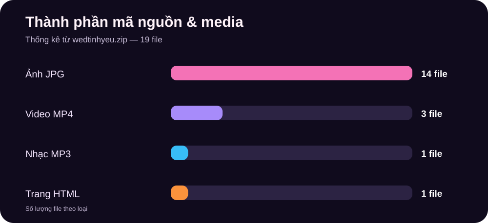
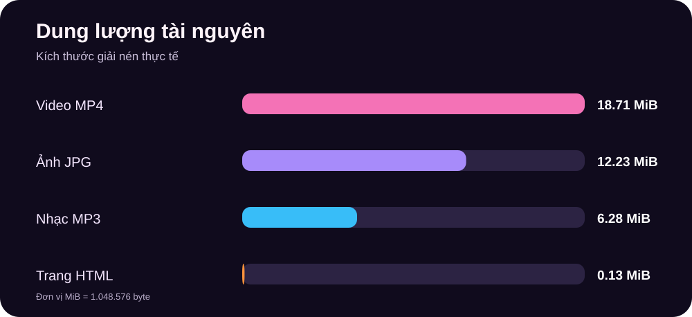
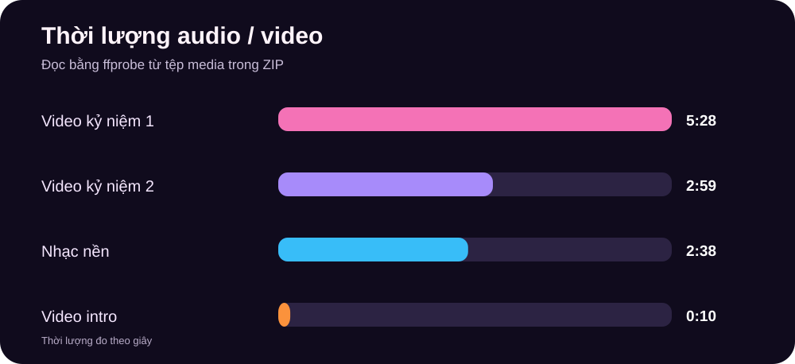
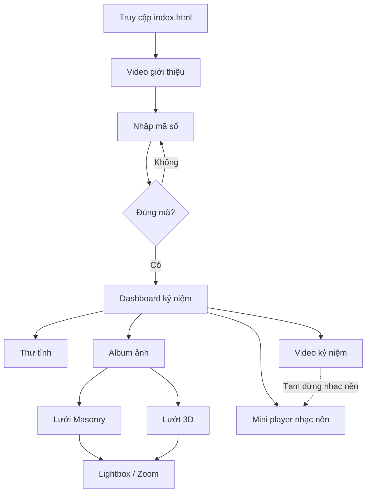
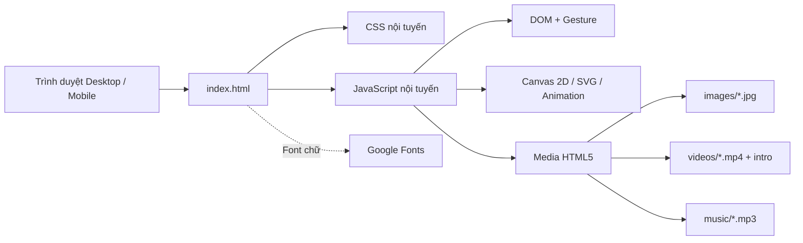

<div align="center">

# 💗 CỦA RIÊNG CHÚNG MÌNH

### Website kỷ niệm tình yêu • Love Memory Website

**Một không gian nhỏ lưu giữ những khoảnh khắc, thư tình, ảnh, video và âm nhạc.**


[📂 Mã nguồn GitHub](https://github.com/luu246luu-del/Wedtenhiu) · [🚀 Trang web GitHub Pages (nếu đã bật)](https://luu246luu-del.github.io/Wedtenhiu/)

</div>

> **Về dự án:** Đây là website tĩnh được xây dựng bằng HTML, CSS và JavaScript thuần, sử dụng các tệp ảnh, video và MP3 lưu ngay trong repository. Dự án không có Backend, cơ sở dữ liệu hoặc AI. Những số liệu ở phần thống kê được đo từ bản `wedtinhyeu.zip` được cung cấp, không phải số liệu người dùng truy cập hay benchmark hiệu năng.

---

## 📖 Mục lục

1. [Tổng quan](#-tổng-quan)
2. [Tính năng đã có](#-tính-năng-đã-có)
3. [Thống kê dự án và biểu đồ](#-thống-kê-dự-án-và-biểu-đồ)
4. [Luồng trải nghiệm](#-luồng-trải-nghiệm)
5. [Công nghệ và kiến trúc](#-công-nghệ-và-kiến-trúc)
6. [Cấu trúc thư mục](#-cấu-trúc-thư-mục)
7. [Hướng dẫn chạy dự án](#-hướng-dẫn-chạy-dự-án)
8. [Tùy chỉnh nội dung](#-tùy-chỉnh-nội-dung)
9. [Đăng lên GitHub Pages](#-đăng-lên-github-pages)
10. [Tương tác và hiệu ứng](#-tương-tác-và-hiệu-ứng)
11. [Giới hạn và lưu ý](#-giới-hạn-và-lưu-ý)
12. [Kiểm tra chất lượng](#-kiểm-tra-chất-lượng)
13. [Định hướng mở rộng](#-định-hướng-mở-rộng)

## 🌷 Tổng quan

**Của riêng chúng mình** là một website kỷ niệm tình yêu theo phong cách lãng mạn, tương tác. Trang mở đầu bằng video giới thiệu, tiếp đến là màn hình nhập mã kỷ niệm, rồi đưa người xem đến dashboard có bộ đếm thời gian, thư tình, album ảnh và video.

| Thuộc tính | Thông tin |
|---|---|
| Tên hiển thị | **Của riêng chúng mình** |
| Repository | [`luu246luu-del/Wedtenhiu`](https://github.com/luu246luu-del/Wedtenhiu) |
| Loại ứng dụng | Website tĩnh, một trang (single-page experience) |
| Ngôn ngữ | Tiếng Việt |
| Frontend | HTML5, CSS3, JavaScript ES6+ |
| Framework frontend | Không dùng React/Vue/Angular |
| Backend, database | **Không có** |
| Công nghệ hiệu ứng | CSS animations, Canvas 2D, SVG, Web Animations API |
| Media | JPG, MP4, MP3 |
| Thiết bị hướng tới | Desktop và thiết bị cảm ứng (có xử lý touch/gesture) |
| Điểm khởi chạy | `index.html` |
| Phương thức phát hành | GitHub Pages hoặc static hosting |

## ✨ Tính năng đã có

| Nhóm | Chức năng | Trạng thái trong mã nguồn |
|---|---|---|
| 🎞️ Giới thiệu | Video mở đầu `intro-cleaned.mp4`, nút bỏ qua, chuyển cảnh cửa mở | ✅ Có mã triển khai |
| 🔢 Mở khóa | Bàn phím số, dấu chấm mật mã, rung/phản hồi và hiệu ứng kính vỡ | ✅ Có mã triển khai |
| ⏳ Kỷ niệm | Bộ đếm ngày, giờ, phút, giây từ ngày bắt đầu | ✅ Có mã triển khai |
| 💌 Thư tình | Trang thư với tiêu đề, lời chào, đoạn văn, lời kết, chữ ký | ✅ Có mã triển khai |
| 🖼️ Album ảnh | 12 ảnh kỷ niệm, chú thích, bố cục lưới Masonry | ✅ Có mã triển khai |
| 🎠 Album 3D | Chế độ lướt ảnh dạng Coverflow, thao tác vuốt | ✅ Có mã triển khai |
| 🔍 Xem ảnh | Lightbox, ảnh trước/sau, zoom, pinch-to-zoom và kéo ảnh | ✅ Có mã triển khai |
| 📹 Video | Danh sách video, bộ phát; tùy chọn khung ngang/dọc | ✅ Có mã triển khai |
| 🎵 Âm nhạc | Mini player, play/pause, trước/sau, vòng tiến trình | ✅ Có mã triển khai |
| 🎚️ Audio focus | Tạm dừng nhạc nền khi video phát, khôi phục khi video dừng | ✅ Có mã triển khai |
| 💖 Hoạt ảnh | Trái tim, hạt sáng, hiệu ứng chạm, parallax, chuyển trang Canvas | ✅ Có mã triển khai |
| 📱 Tương tác cảm ứng | Vuốt, nhấn, chạm, kéo và thao tác phóng to | ✅ Có mã triển khai |

**Luồng sử dụng:** Video intro → nhập mã số → dashboard kỷ niệm → chọn Thư tình / Album ảnh / Video. Nhạc nền có thể phát sau thao tác mở khóa, tùy chính sách autoplay của trình duyệt.

### Một số điểm nổi bật

- **Bộ đếm thời gian:** Tự cập nhật theo thời gian thực; hiển thị tổng ngày yêu cùng giờ, phút, giây.
- **Album hai chế độ:** Chuyển qua lại giữa **Lưới ghép** và **Lướt 3D**; ảnh có caption riêng.
- **Lightbox:** Hỗ trợ phóng to ảnh bằng thao tác hai ngón trên điện thoại, kéo ảnh sau khi zoom và điều hướng giữa các ảnh.
- **Video tích hợp:** Hai video kỷ niệm có cấu hình `orientation`; khi chuyển sang xem video, ứng dụng ưu tiên audio video so với nhạc nền.
- **Chuyển cảnh:** Hiệu ứng trái tim xanh tạo từ chữ “I love you” khi mở thư; hiệu ứng trái tim hồng hạt bụi khi mở album.
- **Hiệu ứng intro có phương án dự phòng:** Nếu trình duyệt chặn autoplay hoặc file media báo lỗi, mã nguồn có xử lý bỏ qua màn hình giới thiệu để tránh đứng ở màn đen.

## 📊 Thống kê dự án và biểu đồ

Các con số dưới đây được **đếm trực tiếp từ ZIP nguồn**, không phải lượt truy cập hoặc số liệu ước lượng.

| Chỉ số | Số lượng / dung lượng |
|---|---:|
| Tổng file thực tế | **19** |
| Ảnh JPG | **14** (12 ảnh album + ảnh thư + ảnh bìa) |
| Video MP4 | **3** (1 intro + 2 video kỷ niệm) |
| Âm thanh MP3 | **1** |
| Tệp mã nguồn HTML/CSS/JS | **1** (`index.html`, có CSS/JS nội tuyến) |
| Dòng mã HTML (bao gồm CSS/JS) | **2.493** |
| Dung lượng giải nén toàn bộ file | **37,34 MiB** |
| File tải ngoài qua CDN trong `<head>` | Google Fonts (không phải thư viện JS) |

### Biểu đồ 1 — Số lượng file



### Biểu đồ 2 — Dung lượng theo loại tài nguyên



| Nhóm tài nguyên | Dung lượng giải nén |
|---|---:|
| Video MP4 | **18,71 MiB** |
| Ảnh JPG | **12,23 MiB** |
| Nhạc MP3 | **6,28 MiB** |
| HTML + CSS + JavaScript | **0,13 MiB** |

> MiB là đơn vị nhị phân (1 MiB = 1.048.576 byte). Tổng dung lượng khi tải trên mạng phụ thuộc HTTP compression, cache và cấu hình máy chủ.

### Biểu đồ 3 — Thời lượng các file media



| Tệp | Thời lượng đo bằng `ffprobe` |
|---|---:|
| `intro-cleaned.mp4` | **00:10** |
| `videos/video1.mp4` | **05:28** |
| `videos/video2.mp4` | **02:59** |
| `music/bai1.mp3` | **02:38** |

*Các giá trị hiển thị đã làm tròn đến giây gần nhất.*

### Dữ liệu được trình bày ở đâu?

- **12 ảnh chính** được cấu hình trong mảng `PHOTOS` và hiển thị ở album.
- **Hai video kỷ niệm** được khai báo trong `VIDEOS`; một video intro nằm ngoài danh sách này.
- **Một bài nhạc nền** được khai báo trong `PLAYLIST`.
- Hai tệp `images/thu-tinh.jpg` và `images/video-bia.jpg` có trong ZIP nhưng không nằm trong mảng 12 ảnh album mặc định.

## 🧭 Luồng trải nghiệm



> Sơ đồ trên mô tả luồng theo mã nguồn. Đây không phải số liệu theo dõi hành vi người dùng.

## 🛠️ Công nghệ và kiến trúc



**Đặc điểm kiến trúc:**

- Toàn bộ HTML, CSS và JavaScript ứng dụng cùng nằm trong `index.html`; không có bước bundling/build bắt buộc.
- Nội dung cá nhân hóa tập trung tại khối `CẤU HÌNH` gần đầu phần `<script>`.
- Logic chia thành các module JavaScript dạng IIFE/closure, như `Music`, `Counter`, `Transition`, `Views`, `Lightbox`, `Album`, `Dashboard`, `Lock`, `Intro`.
- Giao diện sử dụng `requestAnimationFrame`, Canvas 2D, transform và animation cho các hiệu ứng chuyển cảnh.
- Dự án có xử lý cảm ứng, vuốt/gesture, rung qua `navigator.vibrate` khi trình duyệt hỗ trợ.
- Một số trình duyệt/thiết bị có thể không hỗ trợ đầy đủ rung hoặc tự phát nhạc/video.

## 📁 Cấu trúc thư mục

```text
Wedtenhiu/
├── index.html                  # Điểm vào, HTML + CSS + JavaScript
├── intro-cleaned.mp4           # Video giới thiệu 10 giây
├── images/
│   ├── anh1.jpg                # Ảnh album 1
│   ├── ...
│   ├── anh12.jpg               # Ảnh album 12
│   ├── thu-tinh.jpg            # Tài nguyên hình ảnh bổ sung
│   └── video-bia.jpg           # Tài nguyên hình ảnh bổ sung
├── music/
│   └── bai1.mp3                # Nhạc nền
├── videos/
│   ├── video1.mp4              # Video kỷ niệm 1
│   └── video2.mp4              # Video kỷ niệm 2
├── docs/
│   └── assets/
│       ├── thong-ke-so-luong.svg
│       ├── dung-luong-theo-loai.svg
│       └── thoi-luong-media.svg
└── README.md                   # Tài liệu và thống kê dự án
```

Thư mục `docs/` và file `README.md` do bản tài liệu này bổ sung; các file website/media giữ nguyên từ ZIP gốc.

## 🚀 Hướng dẫn chạy dự án

### Cách 1 — Mở trực tiếp

1. Tải/clone repository.
2. Mở thư mục dự án.
3. Mở `index.html` bằng Chrome, Edge hoặc trình duyệt hiện đại.

> Với giao thức `file://`, một số trình duyệt có thể hạn chế việc truy cập media. Nên dùng máy chủ HTTP cục bộ như cách 2.

### Cách 2 — Dùng Python HTTP server (khuyến nghị)

**Windows PowerShell:**

```powershell
cd D:\DuAn\Wedtenhiu
py -m http.server 5500
```

Mở địa chỉ: **http://localhost:5500**.

Nếu máy dùng `python` thay vì `py`:

```powershell
python -m http.server 5500
```

### Cách 3 — VS Code Live Server

1. Mở thư mục repository trong VS Code.
2. Cài extension **Live Server** (nếu chưa có).
3. Chuột phải `index.html` → **Open with Live Server**.
4. Trình duyệt tự mở địa chỉ localhost của extension.

**Không cần** `npm install`, Node.js, database hay API server để chạy website này.

## ✍️ Tùy chỉnh nội dung

Mở `index.html`, tìm khối có dòng chú thích **`CẤU HÌNH: CHỈ CẦN SỬA KHỐI NÀY ĐỂ THAY DỮ LIỆU`**, ở phần JavaScript. Những mục quan trọng:

| Tên cấu hình | Chức năng | Ví dụ định dạng |
|---|---|---|
| `PASSCODE` | Mã số mở màn hình kỷ niệm | Chuỗi gồm 4–8 chữ số |
| `PASSCODE_HINT` | Gợi ý nhập mã | Chuỗi tiếng Việt |
| `AUTOPLAY_MUSIC_ON_UNLOCK` | Thử phát nhạc sau khi mở khóa | `true` / `false` |
| `LOVE_START_DATE` | Mốc bắt đầu tính ngày yêu | `YYYY-MM-DDTHH:mm:ss` |
| `NAMES` | Tên hai người trên dashboard | `{ him: 'Anh', her: 'Em' }` |
| `BG_IMAGE_URL` | Ảnh nền riêng, để rỗng dùng nền SVG tự vẽ | `'images/nen.jpg'` |
| `PHOTOS` | Danh sách ảnh + caption | Mảng `{src, w, h, caption}` |
| `VIDEOS` | Danh sách video kỷ niệm | Mảng `{title, desc, orientation, src, poster}` |
| `PLAYLIST` | Bài nhạc nền | Mảng `{title, artist, src}` |
| `LETTER` | Nội dung thư tình | `{title, greeting, paragraphs, closing, signature}` |
| `TRANSITION_LETTER_SECONDS` | Độ dài hiệu ứng mở thư | Số giây |
| `TRANSITION_ALBUM_SECONDS` | Độ dài hiệu ứng mở album | Số giây |

### Thay ngày kỷ niệm

Tìm dòng `LOVE_START_DATE`, chỉnh thời điểm theo giờ địa phương của người mở trình duyệt:

```js
const LOVE_START_DATE = '2024-02-14T20:00:00';
```

*Giá trị trên chỉ là ví dụ minh họa, không phải ngày mặc định đang có trong dự án.*

### Thay ảnh album

1. Chép ảnh của bạn vào `images/`, chẳng hạn `images/anh13.jpg`.
2. Tìm mảng `PHOTOS`.
3. Thêm phần tử tương ứng:

```js
{ src: 'images/anh13.jpg', w: 900, h: 1200, caption: 'Kỷ niệm đáng nhớ' }
```

4. Lưu file và tải lại trình duyệt. Nên tối ưu dung lượng ảnh trước khi commit.

### Thay video

1. Chép MP4 vào `videos/`.
2. Tìm mảng `VIDEOS`, sửa `src` và `orientation` (`'landscape'` hoặc `'portrait'`).
3. Với video mở đầu, thay `intro-cleaned.mp4` cùng tên, hoặc sửa `src` của phần tử `<video id="introVideo">`.
4. Nếu media không phát, kiểm tra đường dẫn và định dạng mã hóa tương thích trình duyệt (thường H.264 + AAC cho MP4).

### Thay nhạc nền

1. Chép tệp MP3 vào `music/`.
2. Tìm mảng `PLAYLIST` và chỉnh `title`, `artist`, `src`.
3. Người dùng có thể phải tương tác với trang trước khi trình duyệt cho phát nhạc.

### Thay nội dung thư

Tìm đối tượng `LETTER`, chỉnh `title`, `greeting`, `paragraphs`, `closing` và `signature`. Có thể bổ sung nhiều đoạn văn bằng cách thêm chuỗi vào mảng `paragraphs`.

## 🌐 Đăng lên GitHub Pages

Repository hiện có: **https://github.com/luu246luu-del/Wedtenhiu**.

1. Mở repository → **Settings** → **Pages**.
2. Tại **Build and deployment**, chọn **Deploy from a branch** (nếu sử dụng chế độ này).
3. Chọn nhánh **`main`** và thư mục **`/(root)`** → **Save**.
4. Đảm bảo `index.html`, `images/`, `music/`, `videos/` ở **thư mục gốc của repository**.
5. Sau khi quá trình triển khai hoàn tất, trang thường có dạng: `https://luu246luu-del.github.io/Wedtenhiu/`.

**Lưu ý:** README chỉ là tài liệu của GitHub; việc thêm nó không yêu cầu sửa `index.html`, không làm đổi giao diện website và không tự tạo Backend.

## 🎨 Tương tác và hiệu ứng

| Module trong HTML | Vai trò |
|---|---|
| `Puffy` | Trái tim trang trí dạng SVG / hiệu ứng mềm |
| `Parallax` | Chuyển động theo cuộn và tương tác |
| `FX` | Canvas hạt sáng, mưa tim, hiệu ứng chạm |
| `Music` | Phát MP3, mini player, tạm dừng khi video phát |
| `Counter` | Đếm thời gian từ mốc kỷ niệm |
| `Transition` | Chuyển cảnh trái tim xanh/hồng |
| `Views` | Điều khiển mở và đóng các trang nội dung |
| `Lightbox` | Xem ảnh lớn, zoom và chuyển ảnh |
| `Album` | Lưới ảnh và Coverflow 3D |
| `Dashboard` | Trang chính, thẻ 3D và tương tác |
| `Lock` | Nhập mã và hiệu ứng mở khóa |
| `Intro` | Phát video giới thiệu và chuyển sang màn nhập mã |

Mã nguồn có khai báo `prefers-reduced-motion` để tham chiếu tùy chọn giảm chuyển động; việc tuân thủ đầy đủ trên mọi hiệu ứng cần được kiểm thử bổ sung.

## ⚠️ Giới hạn và lưu ý

1. **Mã mở khóa không phải xác thực an toàn.** `PASSCODE` được lưu trực tiếp trong JavaScript, người truy cập có thể đọc bằng View Source/DevTools. Không dùng cách này để bảo vệ dữ liệu riêng tư.
2. **Repository đang Public.** Ảnh, video, thư tình và file âm thanh đưa vào repo đều có thể được truy cập hoặc tải xuống. Chỉ đăng nội dung mà bạn có quyền công khai và sử dụng.
3. **Không có lưu trữ dữ liệu người dùng.** Website không có đăng ký, đăng nhập máy chủ, bình luận, quản trị nội dung hay cơ sở dữ liệu.
4. **Không có Backend/AI.** Không nhầm với các dự án FastAPI hoặc VanMusic khác.
5. **Autoplay khác nhau theo trình duyệt.** Nhạc thường cần người dùng tương tác; video mở đầu có cơ chế fallback.
6. **Google Fonts tải qua mạng.** Nếu mất Internet, trình duyệt dùng font dự phòng.
7. **Dung lượng media đáng kể.** Tổng nội dung giải nén khoảng 37,34 MiB, nên tối ưu ảnh và video nếu cần tốc độ tải tốt trên 4G.
8. **Dữ liệu thống kê là dữ liệu nguồn.** Chưa có số đo PageSpeed/Lighthouse, lượng khách truy cập, FPS thực tế hoặc thống kê sản phẩm từ Analytics; README không tự gán những chỉ số đó.

## 🧪 Kiểm tra chất lượng

Phần tài liệu này được đối chiếu với các file trong bản ZIP:

| Kiểm tra | Kết quả |
|---|---|
| Tệp ZIP đọc được | ✅ |
| Có `index.html` | ✅ |
| 12 đường dẫn ảnh album trỏ tới file trong ZIP | ✅ |
| 2 đường dẫn video kỷ niệm trỏ tới file trong ZIP | ✅ |
| Có video intro | ✅ |
| Có một file MP3 dùng làm nhạc nền | ✅ |
| Đếm số lượng và dung lượng file | ✅ |
| Đọc metadata thời lượng bằng ffprobe | ✅ |
| Đánh giá tốc độ trên thiết bị thật | ⏳ Chưa thực hiện |
| Test đa trình duyệt thực tế | ⏳ Chưa thực hiện |

> Số liệu và trạng thái kiểm tra trên chỉ mô tả việc **rà soát file nguồn**; không có nghĩa mọi tính năng đã được thử thủ công trên điện thoại thực tế.

## 🔮 Định hướng mở rộng

Các ý tưởng sau là **định hướng**, chưa có trong phiên bản hiện tại:

- Tách CSS, JavaScript thành nhiều file để dễ bảo trì.
- Thêm lazy-loading / nén ảnh WebP / tối ưu video để giảm tải mạng.
- Thêm giao diện chỉnh sửa kỷ niệm mà không cần sửa mã.
- Bổ sung PWA để truy cập thuận tiện trên di động.
- Chạy kiểm thử Lighthouse, kiểm tra Accessibility và đa trình duyệt.
- Nếu thật sự cần nội dung riêng tư, chuyển sang cơ chế xác thực trên máy chủ cùng phân quyền đọc dữ liệu.

---

<div align="center">

**💗 Lưu giữ từng khoảnh khắc — Của riêng chúng mình 💗**

*Dự án được tài liệu hóa dựa trên mã nguồn đã cung cấp, không tự thêm tính năng chưa tồn tại.*

</div>
